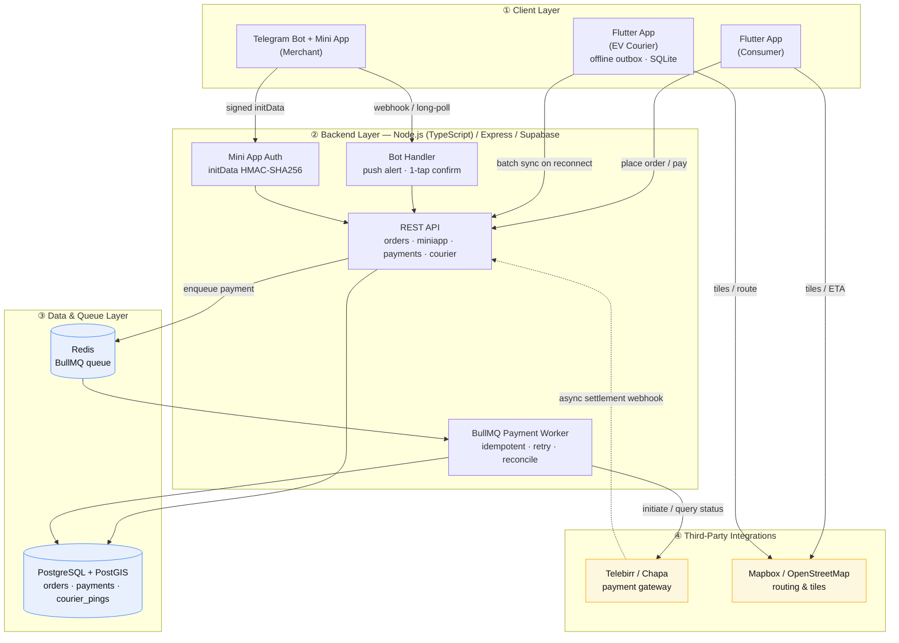
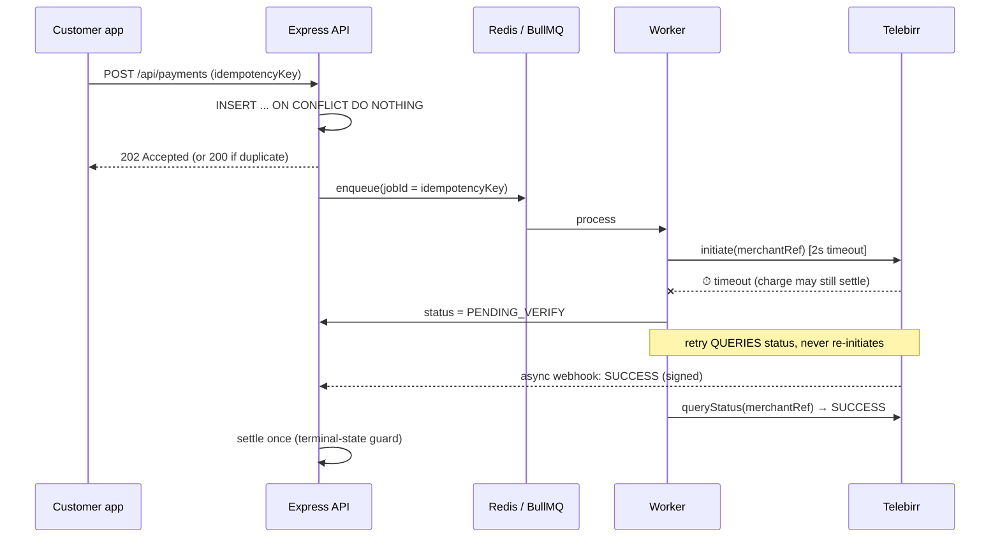

# E-Commerce — Wellness Retail Ops Layer for Addis Ababa


A working prototype of the operational backbone for a wellness e-commerce platform
built for the realities of Addis Ababa: a **Telegram-native merchant interface**,
**payment processing that survives Telebirr downtime**, and **offline-first courier
tracking** for the city's low-connectivity zones.

The guiding principle throughout is **pragmatism over over-engineering** — the whole
stack is open-source building blocks (grammY, Express, BullMQ, Postgres/PostGIS,
Redis) wired together cleanly, not infrastructure reinvented from scratch.

```
┌────────────┐   ┌──────────────┐   ┌──────────────────────────┐
│  Telegram  │──▶│ Node + TS    │──▶│ Postgres (PostGIS) + Redis│
│ Bot + TMA  │   │ Express API  │   │  orders · payments · pings│
└────────────┘   │ BullMQ worker│   └──────────────────────────┘
┌────────────┐   │              │         ▲
│  Flutter   │──▶│              │─────────┘ Telebirr / Chapa (async webhooks)
│ courier app│   └──────────────┘
└────────────┘
```

---

## System Architecture



### How the layers map to this repo

| Layer | Specified stack | Where it lives |
|-------|-----------------|----------------|
| **① Client** | Flutter (Consumer & Courier) + Telegram Bot & Mini App | `packages/courier_sync/` (Dart), `apps/backend/src/bot/`, `apps/backend/src/miniapp/public/` |
| **② Backend** | Node.js (TypeScript) / Supabase / Express | `apps/backend/src/` |
| **③ Data & Queue** | PostgreSQL (PostGIS) + Redis | `docker-compose.yml`, `apps/backend/src/db/schema.sql` |
| **④ Integrations** | Telebirr / Chapa + Mapbox / OSM | `apps/backend/src/payments/telebirr.mock.ts` |

> **On Supabase:** the backend talks to Postgres over a standard `DATABASE_URL`, so
> pointing it at a hosted Supabase project is a config change, not a code change.
> For a self-contained, reviewable demo we run Postgres+PostGIS locally via Docker.

---

## The three tasks

### Task 1 — Hybrid Telegram Merchant Interface (Bot + Mini App)
`apps/backend/src/bot/` · `apps/backend/src/miniapp/`

- **Push Alert.** The bot pushes a new-order message with two inline buttons —
  `✅ In Stock – Confirm` and `🛍 Open Store Portal` (`bot/bot.ts`).
- **1-Tap Fast Confirmation.** Tapping confirm transitions the order to
  `READY_FOR_PICKUP` and replies with the measured backend latency — comfortably
  under the 2-second SLA. The transition is guarded by a state machine
  (`orders/order.types.ts`) and an atomic conditional UPDATE, so a double-delivered
  callback can't corrupt state.
- **Mini App (TMA).** `Open Store Portal` launches a lightweight webview
  (`miniapp/public/index.html`) that shows mock inventory. The merchant is
  authenticated **without a password** by validating Telegram's `initData`
  HMAC-SHA256 signature **server-side** (`miniapp/verifyInitData.ts`) — with replay
  protection on `auth_date`. Covered by unit tests (`verifyInitData.test.ts`).

### Task 2 — Resilience Patterns
`apps/backend/src/payments/` · `packages/courier_sync/`

- **Telebirr API Downtime.** A BullMQ queue worker (`payments/payments.queue.ts`)
  accepts a payment intent and returns `202` in milliseconds regardless of gateway
  health. Exactly-once billing is enforced by **three layers of idempotency**: a
  `UNIQUE` DB key, a BullMQ `jobId`, and the gateway's own merchant reference. On a
  timeout the charge is parked as `PENDING_VERIFY` and reconciled asynchronously —
  **retries query status, they never re-initiate**, so a timed-out-but-successful
  charge is never repeated. A periodic **reconciler sweep** (`payments/reconciler.ts`)
  is the final backstop for anything the webhook and the queue's retries both miss.
  (See [Payment flow](#payment-resilience-flow) below.)
- **Offline Courier Sync.** A Dart/Flutter module (`packages/courier_sync/`) writes
  every location ping and delivery confirmation to a local **SQLite outbox** first,
  never blocking the UI on the network. On reconnect it **flushes in batches**, with
  device-generated ids so replayed uploads are deduplicated server-side. Five unit
  tests cover the offline→reconnect path.

### Task 3 — System Architecture Diagram
This document (the Mermaid diagram above).

---

## Payment resilience flow



---

## Running it

### Prerequisites
- Node ≥ 20 and `pnpm` (`corepack enable`)
- Docker (for Postgres + Redis)

### 1. Start infrastructure and install
```bash
docker compose up -d          # Postgres (PostGIS) + Redis
pnpm install
cp .env.example apps/backend/.env
```

### 2. Run the backend
```bash
pnpm dev                      # migrates schema, starts API + worker (+ bot if token set)
```

### 3. See the payment resilience in action (no Telegram needed)
```bash
pnpm --filter @ecommerce/backend demo:payment
```
You'll watch the same payment get submitted twice (the duplicate is ignored),
time out against Telebirr, park as `PENDING_VERIFY`, and reconcile to a single
`SUCCESS` — never double-charged.

### 4. Tests
```bash
pnpm --filter @ecommerce/backend test        # initData HMAC validation
# Dart module (needs Flutter/Dart SDK):
cd packages/courier_sync && dart pub get && dart test
```

### 5. Go live on Telegram (for the demo video)
1. In Telegram, message **@BotFather** → `/newbot` → copy the token.
2. Put it in `apps/backend/.env` as `TELEGRAM_BOT_TOKEN`.
3. The Mini App button needs an HTTPS URL. Expose the server with a tunnel:
   ```bash
   npx cloudflared tunnel --url http://localhost:3000
   ```
   Set `PUBLIC_BASE_URL` in `.env` to the `https://…` URL it prints.
4. Restart `pnpm dev`, message your bot `/start` (it echoes your chat id), put that
   in `MERCHANT_CHAT_ID`, then run `pnpm seed:order` to push **Order #1048**.

> The bot itself uses long-polling, so only the Mini App button needs the tunnel.

---

## Key engineering decisions

- **One process, one language where it counts.** Bot, API, Mini App host, and
  payment worker run in a single typed Node service — trivial to run and demo, and
  the pieces split into separate deployables later without rewrites.
- **The database row is the source of truth, not the queue.** Jobs carry only an
  idempotency key; all state lives in Postgres. A lost Redis job can be re-derived;
  a lost payment never can.
- **Idempotency is the backbone, applied twice.** The same "generate an id on the
  client, dedupe on the server" pattern secures both payments (no double charge) and
  courier telemetry (no double-counted delivery).
- **Field-first clients.** The Mini App is ~2KB of dependency-free CSS/JS for
  low-spec Android; the courier app writes to disk before the network so it works
  with no signal at all.

## Repository layout
```
apps/backend/            Node + TypeScript service
  src/bot/               grammY bot: push alert, 1-tap confirm
  src/miniapp/           Mini App webview + initData HMAC validation
  src/payments/          BullMQ worker, idempotency, mock Telebirr gateway
  src/courier/           batch ingest endpoint (PostGIS)
  src/orders/            order state machine + repository
  src/db/                schema + migration
packages/courier_sync/   Dart/Flutter offline-sync module (SQLite outbox)
docker-compose.yml       Postgres (PostGIS) + Redis
```
